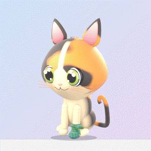

# Assistail extras

  
  

Optional packs for [Assistail](https://github.com/NaveedMohammed/assistail), the taskbar buddy: reminders, timers and
routines. Install them from inside the app (right-click your buddy → **Extras** → **Manage extras…** → **Available**), or
download a pack's zip from `dist/` and drop it on your buddy.

Packs are plain JSON. They can only use what the app allows (say something, do a trick, count, wait for a click), so a
pack can't run programs or reach the internet.

## Packs

| Pack | What it does |
|---|---|
| 🍅 [Pomodoro timer](packs/pomodoro/extra.json) | Focus in rounds with short breaks. He keeps quiet while you focus and naps during breaks. |
| 🙆 [Stretch reminder](packs/stretch/extra.json) | Every so often he stretches and asks you to join in. |
| 💧 [Water reminder](packs/water/extra.json) | Reminds you to drink some water and counts your glasses for the day. |
| 👀 [Eye break (20-20-20)](packs/eye-break/extra.json) | Every 20 minutes, look at something about 6 m away for 20 seconds. |
| 🌆 [End-of-day nudge](packs/end-of-day/extra.json) | At the end of your day he suggests wrapping up, with what you got done. |

## Buddies

Other buddies to swap in for the lion (Assistail 2.5.0 or newer: *Buddy → Get more buddies…*).

| Buddy | What he's like |
|---|---|
| 🐱 [Calico cat](buddies/cat.json)    | A calico kitten with a plaid cloth tied on his paw. He tries to pull it off, licks your pointer, and runs away when you try to put it back on. |

A buddy is a set of animation frames, so its zip is too big for the repo: it's a release asset
(`releases/download/buddy-<id>-<version>/<id>-<version>.zip`), and `buddies/<id>.json` records its size and SHA-256.
The app installs buddies only from this signed catalog, and checks every file in the zip before it opens any of them.

## How the catalog works

- `packs/<id>/extra.json`: the packs, as people write them.
- `dist/<id>-<version>.zip`: what the app downloads (each zip holds only `extra.json`).
- `index.json`: the list the app shows, with each zip's size and SHA-256.
- `index.json.sig`: the maintainer's signature of `index.json`. The app has the matching public key built in and refuses
  an index that doesn't verify, and any zip whose hash doesn't match.

`index.json`, `index.json.sig` and `dist/` are only ever rebuilt by the maintainer (see [CONTRIBUTING.md](CONTRIBUTING.md)).

## Privacy

The app downloads `index.json` when you open the Extras window (and once a day to look for pack updates, which you can
turn off). Nothing about you or your PC is sent. There are no accounts or download counts.

Unofficial community project, not affiliated with Anthropic.
